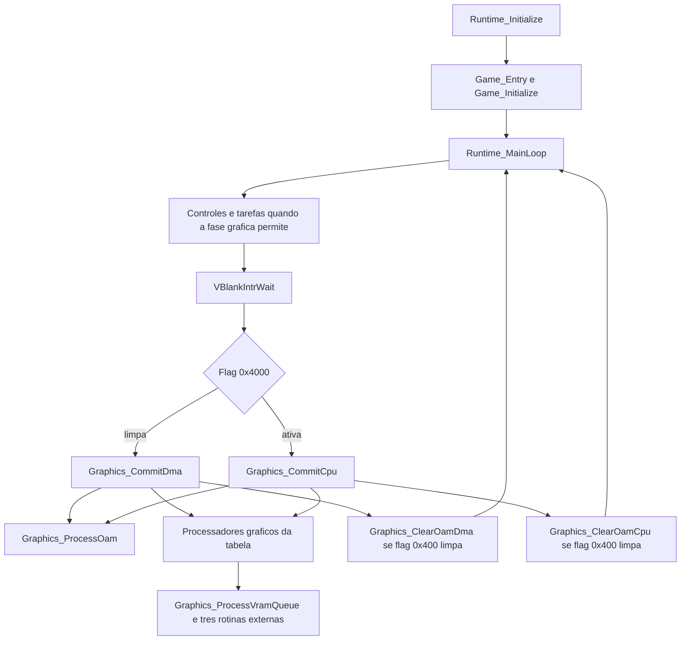

# Inicialização interna e atualização gráfica

Validação em 16/10/2026, ROM USA `BDVE`, SHA-1
`1338584d8cfa57402603197e65d2e2ff0184d24f`.

Esta etapa adicionou **nove funções em C/GNU C, com 4.520/4.520 bytes iguais à ROM**.
Esta etapa anterior levou o projeto de dez para **19 funções, com 5.608 bytes comparados**.
O total atual é **224 funções e 33.032 bytes**, incluindo a continuação de
[reset serial, buffers e áudio](reset_services_matching.md) e a etapa de
[fundos e serviços](background_processors_services.md).
São 222 alvos com `agbcc` GCC 2.9-arm-000512: 216 com `-O2` e três rotinas
com `-O1` (fila de mapas, carregador de fundos da abertura e `Cgb_Update`), com `-mthumb-interwork`, além de
`Runtime_Memset` com `-O2` sem interworking e `Cgb_Stop` com
`-O2 -mthumb-interwork -fprologue-bugfix`, assim como `Audio_UnlinkChannel`. `MusicEvent_Fine`
compartilha o GCC 3.4.6 com a [parada de trilha](music_track_stop_matching.md)
usa GCC 3.4.6 alternativo; o [callback serial](serial_irq_matching.md) conserva agbcc. Veja [background_queue_matching.md](background_queue_matching.md).

| Alvo do matcher | Função | Endereço | Bytes iguais |
|---|---|---|---:|
| `game_initialize` | `Game_Initialize` | `0x08001350` | 212/212 |
| `runtime_initialize` | `Runtime_Initialize` | `0x0810C228` | 1.764/1.764 |
| `graphics_commit_dma` | `Graphics_CommitDma` | `0x0810CA60` | 724/724 |
| `graphics_finish_dma` | `Graphics_ClearOamDma` | `0x0810CD34` | 224/224 |
| `graphics_commit_cpu` | `Graphics_CommitCpu` | `0x0810CE14` | 528/528 |
| `vram_queue_process` | `Graphics_ProcessVramQueue` | `0x0810D240` | 184/184 |
| `graphics_finish_cpu` | `Graphics_ClearOamCpu` | `0x0810D5C0` | 156/156 |
| `tasks_initialize` | `Tasks_Initialize` | `0x0810D670` | 232/232 |
| `oam_process` | `Graphics_ProcessOam` | `0x08111A88` | 496/496 |

Os tamanhos incluem os literais e os zeros de alinhamento. As nove funções foram integradas
em `src/` e `config/functions.usa.json` após obter matching; os experimentos ficaram em `build/`.

## Inicialização

`Runtime_Initialize` prepara o ambiente chamado pelo startup antes de `Game_Entry`:

- Desabilita interrupções durante a configuração inicial e escreve `WAITCNT = 0x4014`.
- Executa cópias e limpezas DMA para VRAM, OAM, paletas e buffers da IWRAM/EWRAM.
- Inicializa matrizes afins de BG2/BG3 com diagonal `0x100`, sombras de registradores,
  intervalos de repetição de teclas 20/8, índices, filas e listas de callbacks.
- Copia quinze entradas da tabela IRQ da ROM para `0x03001F10`.
- Prepara dois buffers de scanlines com troca de ponteiros, chama os serviços auxiliares
  de inicialização e `Tasks_Initialize`.
- Copia `0x200` bytes a partir de `0x080000FC` para `0x03001F50` e instala esse endereço
  no vetor da BIOS em `0x03007FFC`.
- Configura `IE = 1`, `DISPSTAT = 0x18` e `IME = 1`, nessa ordem, e limpa os buffers finais.

As chamadas auxiliares de áudio, heap, armazenamento e comunicação ainda apontam para as
funções originais. O corpo completo de `Runtime_Initialize` já é reconstruído, mas sua árvore
inteira de dependências ainda não está em C.

`Tasks_Initialize` configura os 128 ponteiros de slots, obtém duas tarefas sentinelas e prepara
a raiz e o primeiro bloco livre do heap de tarefas. A ROM limpa apenas `0x200` bytes do array
de tarefas nessa função; esse tamanho foi preservado, embora os 128 registros de 20 bytes
ocupem mais espaço. A obtenção de slots em `0x0810DBD0` também tem matching.

`Game_Initialize` chama os inicializadores específicos do jogo, limpa um bloco de 80 bytes e
seleciona caminhos por `gSystemFlags & 0x100` e pelo retorno de `0x08001538`. Ela retorna 0 ou 1;
o chamador ignora esse resultado. O bit 0 de `gDbaaGameState.byte02` é copiado para três bytes
em `0x02029FC8`. A finalidade desses três bytes ainda não foi estabelecida.

## Caminho de vídeo



O diagrama resume chamadas condicionais; o C conserva a ordem e todos os caminhos de retorno.

Os dois caminhos de commit transferem sombras de controle dos backgrounds, janelas, blend,
scroll e matrizes afins. As flags 1 e 2 solicitam atualização das paletas de BG e OBJ.
O caminho DMA configura o canal 3 diretamente; o caminho CPU usa `CpuSet`/`CpuFastSet` da BIOS.
Os endereços de registradores, paletas e OAM correspondem às
[definições do libgba](https://github.com/devkitPro/libgba/blob/master/include/gba_video.h).

Há quatro slots para callbacks de HBlank e seis para callbacks de VBlank. O commit executa
os callbacks ativos de VBlank e depois prepara a lista solicitada para a passagem seguinte.
No caminho DMA, a flag 4 também habilita a cópia inicial do buffer de scanlines.

`Graphics_ProcessOam` percorre 32 listas de ordenação, monta o buffer de sprites e registra
a ordem de cópia. Cada entrada tem oito bytes, mas a cópia dos atributos transfere somente
seis; o quarto halfword fica disponível para os parâmetros afins. As flags `0x400` e `0x800`
selecionam a movimentação e limpeza de regiões usadas pelo mecanismo de pausa.
Essa associação com pausa é corroborada pela rotina equivalente no projeto de referência
citado abaixo; as operações de memória estão confirmadas nesta ROM.

As duas funções `Graphics_ClearOam*` alternam os buffers de scanlines, salvo quando a flag
`0x20` impede a troca, limpam flags de callbacks/cópia e preenchem o buffer OAM com `0x200`.
O caminho DMA divide o preenchimento em quatro trechos; o caminho CPU faz um preenchimento
pela BIOS. As larguras, contagens e leituras de controle originais foram preservadas.

## Fila de VRAM e continuação entre frames

`Graphics_ProcessVramQueue` processa um anel de 128 descritores de 12 bytes. Os campos
`source` e `destination` são endereços de 32 bits, seguidos do tamanho de 16 bits.
Cada transferência usa blocos de até `0x400` bytes. O índice circular avança com máscara `0x7F`.
A função consulta VBlank após concluir um descritor e retorna zero se o período já terminou.

O byte antes chamado genericamente de `gFrameMode` funciona aqui como índice de continuação
da tabela gráfica. `0xFF` indica que os processadores terminaram. Se um processador retorna
zero, o commit guarda seu índice e continua dali na passagem seguinte; enquanto esse byte
for diferente de `0xFF`, o loop principal adia a próxima execução de controles e tarefas.
Esse encadeamento é observado nos corpos recompilados, não depende do nome dado à variável.

Tabela original em `0x08D26710`, com o bit Thumb removido dos endereços abaixo:

| Índice | Endereço | Estado |
|---|---|---|
| 0 | `0x0810D240` | `Graphics_ProcessVramQueue`, matching completo |
| 1 | `0x0810F75C` | `Graphics_ClearBackgrounds`, 612 bytes, matching completo |
| 2 | `0x0810EFB4` | `Graphics_DrawBackgroundSprites`, matching completo |
| 3 | `0x0810DDCC` | Fila de mapas: 2.868 bytes com matching |

## Geração de código e referência de pesquisa

A forma dos blocos C dos macros DMA importa para esse GCC antigo: trocar os escopos simples
por `do/while (0)` altera a geração de código e pode mudar até a alocação das temporárias na
stack. `include/hardware.h` preserva os blocos verificados. Os macros não contêm assembly.

`Graphics_ProcessOam` contém uma exceção explícita: `__asm__("" : : "r"(i))` no loop de limpeza.
É uma dependência vazia de GNU C, que impede a transformação do contador crescente em um
contador decrescente. Não emite instruções, não fixa um registrador e não injeta bytes da ROM.
Ela está registrada no manifesto e em `compiler_barriers` no relatório. A etapa posterior
adicionou duas restrições vazias em `Func_08002AA8`, uma vinculando o valor a `r2`.
O assembly gerado permanece intocado em todos os alvos.

Foi encontrada forte correspondência estrutural com as rotinas do motor documentadas no
projeto [SAT-R/sa2](https://github.com/SAT-R/sa2), inclusive o caminho de inicialização com
esperas DMA da variante `ENGINE_3`. Isso orientou a pesquisa de tipos, macros e nomes.
A revisão exata e a extensão do código compartilhado continuam em análise. Os endereços e
o matching deste projeto são específicos da ROM de Dragon Ball.

Fontes primárias consultadas, revisão `393357f7c9d46b5c10b6c41a57b80fe3b58f3c8d`:

- [Inicialização e commits gráficos](https://github.com/SAT-R/sa2/blob/393357f7c9d46b5c10b6c41a57b80fe3b58f3c8d/src/core.c).
- [Macros DMA e espera](https://github.com/SAT-R/sa2/blob/393357f7c9d46b5c10b6c41a57b80fe3b58f3c8d/include/gba/dma_macros.h).
- [Ordenação OAM e barreira de otimização](https://github.com/SAT-R/sa2/blob/393357f7c9d46b5c10b6c41a57b80fe3b58f3c8d/src/sprite.c).
- [Inicialização de tarefas](https://github.com/SAT-R/sa2/blob/393357f7c9d46b5c10b6c41a57b80fe3b58f3c8d/src/task.c).

## Reproduzir e limites

```powershell
.\.venv\Scripts\python.exe tools\match.py --all
.\.venv\Scripts\python.exe tools\match.py --target runtime_initialize
.\.venv\Scripts\python.exe tools\match.py --target graphics_commit_dma
.\.venv\Scripts\python.exe -m unittest discover -s tests -v
```

Resultado local: **224/224 funções e 190 testes aprovados**, sem testes pulados. Os testes incluem
recompilação de todos os alvos, alteração do controle DMA, de uma chamada e de uma operação C,
rejeição de ROM errada e do mapa de outra ROM, seleção de um manifesto de candidatos separado
e controle contra relatórios antigos.

Os relatórios ficam em `build/matching/<id>/`; `summary.json` agrega os resultados.
`--function-map` permite manter candidatos em um manifesto separado, fora dos alvos de produção.
A seção linkada é comparada inteira, sem cortar bytes excedentes e sem máscaras de relocations.

Ainda não há ROM reconstruída integralmente, boot do conjunto em emulador ou executável PC.
A inicialização e os commits preservam chamadas para código original ainda externo; recursos,
os serviços completos de áudio e EEPROM continuam pendentes. Os quatro processadores gráficos estão concluídos;
a leitura do header e o desenho de sprites em fundos já têm matching integral. O estado detalhado está em
[background_processors_services.md](background_processors_services.md).

A continuação de [tarefas e memória](tasks_memory_matching.md) também concluiu `Task_Create`,
os alocadores usados por ela e a destruição por faixa chamada durante o reset.
