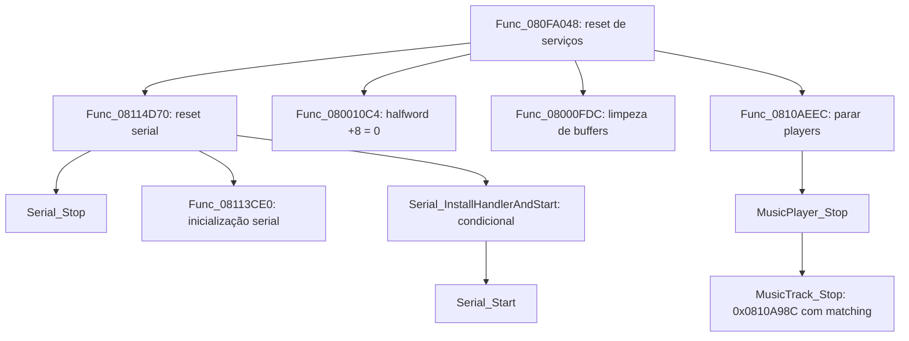

# Reset de comunicação, buffers e áudio

ROM USA `BDVE`, revisão 0, SHA-1 `1338584d8cfa57402603197e65d2e2ff0184d24f`.
Os oito alvos desta etapa foram reconstruídos em C e compilados com o agbcc
GCC 2.9-arm-000512, `-O2 -mthumb-interwork`. São **556/556 bytes iguais à ROM**,
incluindo instruções, pools de literais e alinhamento. Os nomes novos descrevem
o comportamento observado; não foram recuperados símbolos históricos.

| Função em C | Endereço | Fim exclusivo | Bytes | Resultado |
|---|---|---|---:|---|
| `Func_08114D70` | `0x08114D70` | `0x08114DB0` | 64 | Match |
| `Func_080010C4` | `0x080010C4` | `0x080010D0` | 12 | Match |
| `Func_08000FDC` | `0x08000FDC` | `0x0800101C` | 64 | Match |
| `Func_0810AEEC` | `0x0810AEEC` | `0x0810AF18` | 44 | Match |
| `Serial_Stop` | `0x08114138` | `0x08114188` | 80 | Match |
| `Serial_InstallHandlerAndStart` | `0x08115434` | `0x0811545C` | 40 | Match |
| `Serial_Start` | `0x08114DB0` | `0x08114E6C` | 188 | Match |
| `MusicPlayer_Stop` | `0x0810B5D0` | `0x0810B610` | 64 | Match |

Esse marco levou o conjunto de 52 funções e 13.484 bytes a **60 funções e 14.040 bytes
com matching integral**. A continuação do [callback serial](serial_irq_matching.md) e da
[parada de trilha](music_track_stop_matching.md) leva o total atual a 224 funções e 33.032 bytes.
No marco dos oito serviços, eram 59 alvos com `-O2`; a reconstrução anterior da fila
de mapas conserva `-O1` e seus metadados de labels fora da imagem de execução.

## Funções solicitadas

`Func_08114D70`, em `src/reset_link.c`, zera `gInputMode`, limpa o bit `0x10000`
de `gSystemFlags`, para a comunicação e chama a inicialização serial já reconstruída
com argumento zero. Depois dessas chamadas, relê as flags: se `0x80000` estiver ativo,
instala o callback de interrupção e inicia a comunicação novamente. A releitura
conserva a possibilidade de as chamadas alterarem esse estado.

`Func_080010C4`, em `src/game_video_flags_clear.c`, faz uma única escrita de **16 bits**
em `0x02028CB8`, oito bytes após a base `0x02028CB0`. A view `VideoControlState`
preserva o acesso ao campo `half08`; seu significado específico no jogo ainda não está
estabelecido. `gVideoControlState` e `gVideoWords` são aliases da mesma base no mapa.

As quatro chamadas diretas que ainda estavam externas em `Func_080FA048` agora têm
corpos C com matching. O grafo abaixo mostra esse subconjunto e suas dependências:



## Limpeza dos buffers

`Func_08000FDC`, em `src/game_video_reset_buffers.c`, zera o word separado em
`0x02028F68` e faz dois preenchimentos de halfwords usando `Bios_CpuSet`:

| Destino | Halfwords | Bytes | Fim exclusivo |
|---|---:|---:|---|
| `0x02028CB0` | `0x15C` | 696 | `0x02028F68` |
| `0x02028C80` | `0x16` | 44 | `0x02028CAC` |

Os dois zeros locais são distintos: o primeiro fica em `sp+0` e o segundo em `sp+2`.
Reutilizar a mesma variável pode manter o resultado lógico da limpeza, mas altera
as instruções e os argumentos de origem em comparação com esta ROM.

## Comunicação serial

`Serial_Stop` conserva a sequência de escritas e larguras observadas: desliga IME,
aplica `IE &= 0xFF3F`, liga IME, escreve `SIOCNT = 0x2003`, escreve o word `0xBBBC`
em `0x0400010C`, reconhece `0xC0` em IF e limpa o bit alto do byte `gSerialState.flags`,
em `0x03006D88`. O código escreve IME como zero e depois um; não salva o valor anterior.

`Serial_InstallHandlerAndStart` desliga IME, escreve `Serial_IrqHandler` na entrada
zero de `gIrqHandlers`, liga IME e chama `Serial_Start`. O literal compilado é
`0x08114E6D`, com o bit Thumb do endereço `0x08114E6C`. O corpo desse callback
agora tem 560 bytes com matching integral em [serial_irq_matching.md](serial_irq_matching.md).

`Serial_Start`, em `src/serial_start.c`, configura os registradores, zera o byte em
`0x03006FE0` e os 12 bytes em `0x03000870`, habilita os bits de interrupção `0xC0`
e inicia o timer com reload `0x8000` e controle `0xC1`. O acesso que limpa o bit zero
de SIOCNT é de **oito bits**. O temporário C de 32 bits conserva o cálculo da máscara
antes da escrita truncada; isso reproduz a sequência original sem restrições de
registradores ou instruções assembly escritas no fonte.

A estrutura serial antes local a `serial_initialize.c` passou para `include/serial.h`,
com os mesmos offsets. Essa inicialização anterior foi recompilada e continua com
244/244 bytes iguais.

## Parada de áudio

`Func_0810AEEC`, em `src/music_stop_all.c`, percorre os quatro registros de 12 bytes
de `gMusicPlayerTable`, em `0x08A69038`, e chama `MusicPlayer_Stop` para cada player.
O número de players vem do **endereço do símbolo absoluto** `gMusicPlayerCount`, cujo
valor no linker é quatro. Não há leitura de memória no endereço `0x00000004`.

`MusicPlayer_Stop` verifica a assinatura `0x68736D53` em `player+0x34`. Se for válida,
incrementa esse campo, ativa `0x80000000` no status, percorre `trackCount` trilhas
com stride `0x50`, chamando `MusicTrack_Stop`, e restaura a assinatura. O bit de pausa
é distinto de apagar o status inteiro. A função retorna sem alterar o player quando
a assinatura não confere.

As views de player, trilha, canal e estado do mixer foram reunidas em `include/audio.h`.
A inicialização e a configuração de áudio anteriores mantêm 120/120 e 152/152 bytes
iguais depois da troca de header. Os padrões de organização também aparecem na
referência local do [driver m4a do SAT-R/sa2](https://github.com/SAT-R/sa2/blob/393357f7c9d46b5c10b6c41a57b80fe3b58f3c8d/src/lib/m4a/m4a.c).
A evidência do matching é a recompilação deste projeto contra a ROM USA.

## Prova e limites

```powershell
.\.venv\Scripts\python.exe tools\match.py --target reset_link
.\.venv\Scripts\python.exe tools\match.py --target game_video_flags_clear
.\.venv\Scripts\python.exe tools\match.py --target serial_start
.\.venv\Scripts\python.exe tools\match.py --all
.\.venv\Scripts\python.exe -m unittest discover -s tests -v
```

Os oito novos fontes são C estruturado e não contêm inline assembly. O compilador
permanece inalterado. A montagem e o link resolvem chamadas e ponteiros Thumb para os
endereços originais antes da comparação da `.text` inteira. Não há opcodes embutidos,
edição do assembly, recorte de bytes ou máscaras para esconder diferenças.

Naquele marco, a suíte passou com **34 testes, sem skips**, incluindo os 60 alvos.
A validação atual passa com 190 testes e 224 alvos. Os controles
negativos desta etapa alteram a largura da escrita em `half08`, a flag que condiciona
o reinício serial, a máscara IE, o tamanho da limpeza auxiliar e o bit de pausa do
player. Cada cópia alterada é recompilada e linkada e precisa reprovar o matching.
Relatórios e hashes ficam em `build/matching/<id>/report.json`; o agregado está em
`build/matching/summary.json` e a auditoria em `build/verification.json`.

`MusicTrack_Stop`, em `0x0810A98C`, agora tem **68/68 bytes iguais**, usando GCC 3.4.6
alternativo, com `TST` e chamada C indireta resolvida para o ponto `BX r3` em `0x0810A97C`.
Esse ponto continua compartilhado com o epílogo anterior e não conta como outra função C.
O perfil, as dez restrições vazias e o alinhamento de seção estão descritos em
[music_track_stop_matching.md](music_track_stop_matching.md).

Os helpers seriais `0x0811509C`, `0x08115108` e `0x08115144` agora têm matching em
[serial_packets_matching.md](serial_packets_matching.md). Permanecem externos serviços internos do mixer,
wrappers BIOS e callbacks específicos das sequências. `0x080C863C` e onze dependências
agora têm matching em [sequences_initialization_matching.md](sequences_initialization_matching.md). Fechar as
chamadas diretas de `Func_080FA048` não conclui todas as dependências transitivas da
inicialização. Ainda faltam build da ROM inteira, execução do conjunto em emulador e
a camada de hardware do port para PC.
